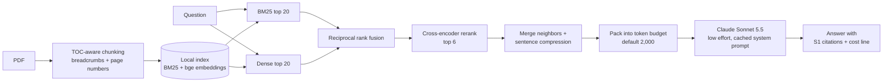

# ragharness

**A token-efficient RAG harness for Claude: ask questions about a PDF and send the model about 0.4% of the book, with page-accurate citations.**


Most RAG demos stuff a pile of chunks into a prompt and hope. This project treats the context window as a budget: every stage of the pipeline either improves retrieval accuracy or cuts tokens, and every answer reports exactly what it cost.

## Highlights

- **Structure-aware ingestion.** PDF table of contents drives chunking. Each chunk keeps its breadcrumb (`Chapter > Section > Subsection`) and exact page range, so answers cite real pages.
- **Hybrid retrieval.** BM25 (exact terms like `802.1X`) plus local `bge-base-en-v1.5` embeddings (meaning), fused with reciprocal rank fusion.
- **Local cross-encoder rerank.** `bge-reranker-base` reorders the fused candidates. Runs on your machine.
- **Fixed token budget.** Neighbor merging and query-focused sentence compression pack context into a cap (default 2,000 tokens).
- **Two answer modes.** `ask` does one retrieval and one Claude call. `agent` lets Claude call a `search_book` tool for multi-part questions, with a capped number of steps.
- **Cost-aware generation.** Claude Sonnet 5.5 at low effort, a frozen system prompt (prompt caching), inline `[S1]` citations, server-side refusal fallbacks, an on-disk answer cache, and per-query token and dollar reporting.
- **Zero-token indexing.** All embedding and reranking is local, so building an index costs no API tokens.
- **Measured, not assumed.** A 40-question retrieval eval is built into the CLI (`rag eval`).

## Pipeline



In `agent` mode, Claude decides what to look up: it calls `search_book` (each call runs the same retrieval pipeline with a smaller per-search budget) and answers once it has what it needs.

## Why token-efficient

- Developed against a **642-page CISSP study guide**: 1,665 chunks, about 375K tokens.
- Each question sends about **1.5K tokens of context, roughly 0.4% of the book**, instead of the whole thing.
- The public demo document (NIST SP 800-61r3) is 96 chunks, about 27K tokens. Each demo question uses **about 5-7% of the document**. See [demo/DEMO.md](demo/DEMO.md) for the retrieved sources per question.
- Repeat questions with identical context are served from the answer cache at 0 tokens.

## Results

Retrieval eval on 40 page-verified questions spread across all 8 CISSP domains (fact, definition, compare and paraphrase types). A hit means a retrieved source covers a page that contains the answer. Reproduce with `rag eval` (no API calls).

<!-- EVAL_TABLE -->
| Method | hit@1 | hit@6 |
|---|---|---|
| BM25 only | 85.0% | 92.5% |
| Hybrid (BM25 + dense, RRF) | 85.0% | 97.5% |
| Hybrid + rerank | 85.0% | 100.0% |

Honest reading: hit@1 is flat at 85% across methods, so the gains show up in recall. Fusion adds 5 points at hit@6 and reranking closes the rest on this set. With only 40 questions, treat these as directional, not a benchmark.

The CISSP book is copyrighted and is **not** in this repo (the question set is in `tests/eval_questions.jsonl`). The harness works on any PDF that has a table of contents; the demo uses the public-domain NIST document instead.

## Quickstart

```bash
python -m venv .venv && source .venv/bin/activate
pip install -e ".[dev]"
cp .env.example .env              # then add your ANTHROPIC_API_KEY

rag ingest demo/nist.sp.800-61r3.pdf          # local models download on first run
rag search "incident response life cycle"     # retrieval only, no API call
rag ask "How should incidents be prioritized?"
rag ask --agent "Compare the role of the Govern function with the Respond function in incident handling."
rag chat                                      # interactive; prefix with /agent for agent mode
rag eval                                      # retrieval accuracy on tests/eval_questions.jsonl
```

To regenerate [demo/DEMO.md](demo/DEMO.md) (retrieved sources, token use, and Claude answers):

```bash
python scripts/demo.py            # retrieval only, no API key needed
python scripts/demo.py --answer   # also generate answers
```

Note: `rag eval` expects an index built from the CISSP book, so it will not score meaningfully against the NIST demo index.

## Configuration

Every setting in `src/ragharness/config.py` can be overridden with an environment variable (or `.env`).

| Variable | Default | Purpose |
|---|---|---|
| `ANTHROPIC_API_KEY` | none | Required for `ask`, `agent`, `chat` |
| `RAG_MODEL` | `claude-sonnet-5-5` | Generation model |
| `RAG_EFFORT` | `low` | Claude effort level |
| `RAG_CONTEXT_BUDGET` | `2000` | Max context tokens sent per question |
| `RAG_TOP_K` | `6` | Chunks kept after reranking |
| `RAG_CANDIDATES` | `20` | Fused candidates passed to the reranker |
| `RAG_CHUNK_TOKENS` | `350` | Target chunk size (estimated, ~4 chars per token) |
| `RAG_CHUNK_OVERLAP_TOKENS` | `50` | Overlap between chunks |
| `RAG_EMBED_MODEL` | `BAAI/bge-base-en-v1.5` | Local embedding model |
| `RAG_RERANK_MODEL` | `BAAI/bge-reranker-base` | Local cross-encoder |
| `RAG_MAX_TOKENS` | `4000` | Max output tokens |
| `RAG_AGENT_MAX_STEPS` | `4` | Step cap in agent mode |
| `RAG_INDEX_DIR` | `./index` | Where the index is stored |
| `RAG_CACHE_DIR` | `./.rag_cache` | Where cached answers are stored |

## Project structure

```
.
├── src/ragharness/
│   ├── config.py      # settings, env overrides, model prices
│   ├── ingest.py      # PDF -> TOC-aware chunks with breadcrumbs and page ranges
│   ├── index.py       # BM25 + dense embedding index (built locally)
│   ├── retrieve.py    # RRF fusion, rerank, neighbor merge, compression, budget packing
│   ├── llm.py         # Claude calls, usage and cost accounting, answer cache
│   ├── harness.py     # ask() and agent() modes
│   └── cli.py         # rag ingest | search | ask | chat | eval
├── scripts/demo.py    # runs the pipeline on the NIST doc, writes demo/DEMO.md
├── tests/
│   ├── test_pipeline.py        # offline unit tests (chunking, fusion, compression)
│   ├── test_harness.py         # ask/agent loops against a fake Claude client
│   └── eval_questions.jsonl    # 40 page-verified retrieval questions
├── demo/
│   ├── nist.sp.800-61r3.pdf    # public-domain demo document
│   └── DEMO.md                 # generated demo output
├── .env.example
└── pyproject.toml
```

## Design decisions

- **Hybrid retrieval, not dense only.** Technical text is full of exact tokens (`802.1X`, `PBKDF2`, `SHA-256`) that embeddings blur and BM25 nails, while paraphrased questions are the reverse. The tokenizer keeps such terms intact, and RRF merges the two rankings without needing comparable scores.
- **Local reranking.** A cross-encoder reads the query and passage together, which is more precise than vector similarity. Running it locally means the extra accuracy costs no API tokens.
- **Compress before sending.** Retrieved chunks contain plenty of filler. Adjacent chunks from the same section are merged, then each hit is cut to its most query-relevant sentences within a share of the budget. The best hit gets at least half the budget.
- **Breadcrumbs and exact pages.** Chunks are split along the TOC, headers and footers are stripped, and each chunk is narrowed to the pages it actually appears on. The breadcrumb is also indexed (section titles count double in BM25), and it makes citations checkable.
- **Answer cache.** Keyed on model, effort, question, retrieved context and chat history, so an identical request never pays twice.
- **Frozen system prompt.** The system prompt has no per-request values in it and per-question content goes last, so the request prefix stays byte-stable. Prompt caching then reuses it in longer `chat` sessions, once the prefix passes the model's minimum cacheable length.
- **Refusal fallbacks.** Security course material can trip safety classifiers, so calls use server-side fallbacks and handle a refusal gracefully.
- **Agent mode is opt-in.** One retrieval and one call is cheaper and enough for most questions. The agent costs more but handles comparisons that a single search misses, so it is a separate flag with a step cap.

## Testing

```bash
pytest
```

The unit tests are offline (no API key or model downloads). They cover the tokenizer, chunk splitting, RRF fusion and context compression, plus the `ask` and `agent` loops (answer cache, step cap, refusal handling) driven by a fake Claude client. Retrieval quality is covered separately by `rag eval`.

## Roadmap

- Replace the ~4 characters-per-token estimate with real token counting.
- Grow the eval set beyond one book and add answer-level grading (faithfulness and citation correctness), not only retrieval hits.
- Add the per-query token and cost numbers for the CISSP set to the README once measured end to end.
- Handle PDFs without a table of contents with a fallback chunker.
- Make the sentence compressor smarter than term overlap (for example, embedding-based scoring), and measure the effect on answer quality.
- Streaming output in `ask` and `chat`.

## What I learned

- Retrieval quality is mostly decided before the LLM: chunk boundaries, metadata and fusion mattered more than prompt wording.
- Measuring beats guessing. Building the eval first showed that reranking helped recall rather than top-1, which I would not have noticed by eyeballing answers.
- Context is a budget. Compression and packing gave large token savings, and the cost line printed on every answer kept me honest about it.
- Small details compound: stripping page headers, rejoining hyphenated words and keeping technical tokens intact each improved what the retriever could find.
- Caching works at two layers (prompt caching for the fixed prefix, an answer cache for repeats), and each needs a deliberately stable input to work.

## License

[MIT](LICENSE)
